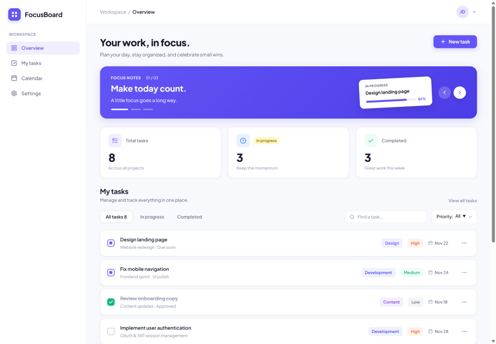
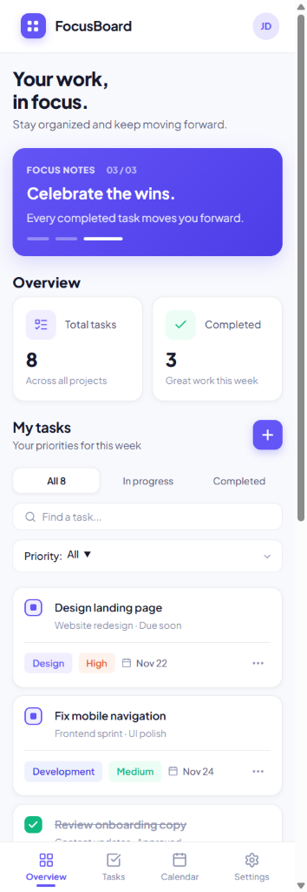

# FocusBoard — Your Work, In Focus

> A responsive, single-user task management dashboard built with React.js, Vite, and modern CSS3, meticulously engineered according to the official Figma design specifications.

**Live Demo**: [https://focusboard-nu-pearl.vercel.app/](https://focusboard-nu-pearl.vercel.app/)  
**GitHub Repository**: [https://github.com/kvsatyanarayana949/focusboard](https://github.com/kvsatyanarayana949/focusboard)

---

## 🎯 Overview & Objective

**FocusBoard** is designed to streamline personal productivity by combining high-level task metrics, motivational focus notes, and comprehensive task management into a clean, modern interface. 

This project fulfills all criteria of the MobileFirst Frontend Trainee Assessment, demonstrating:
- React.js fundamentals, clean component composition, and unidirectional data flow.
- Robust state management with immutable updates and zero-dependency local persistence (`localStorage`).
- Complete CRUD operations (Create, Read, Update, Delete with safety confirmation).
- Dynamic, real-time metrics calculation and completion percentage without hardcoded values.
- Interactive 3-slide Focus Notes carousel with circular navigation and indicator synchronization.
- Multi-parameter cooperative filtering (live title search, status filter tabs, and priority dropdown).
- Responsive layouts tested at Desktop (1440px), Tablet (768px), and Mobile (390px).
- Accessibility compliance with semantic HTML, keyboard operability, and ARIA attributes.

---

## 🛠️ Technology Stack

| Technology | Purpose |
| :--- | :--- |
| **React 19** | Component-based UI architecture |
| **Vite 8** | Modern frontend build tool and dev server |
| **JavaScript (ES6+)** | Application logic and state manipulation |
| **CSS3 & CSS Custom Properties** | Design tokens, responsive layouts (Flexbox & CSS Grid) |
| **React Hooks** | State and lifecycle management (`useState`, `useMemo`, `useEffect`, custom hook) |
| **localStorage API** | Browser-side client persistence |
| **Lucide React** | Feather-light SVG icon system |

---

## ✨ Key Features Implemented

1. **Desktop Dashboard (1440 × 1000)**:
   - Fixed white vertical sidebar with purple brand icon, workspace navigation (`Overview`, `My tasks`, `Calendar`, `Settings`).
   - Breadcrumb navigation (`Workspace / Overview`) and user profile avatar (`JD`).
   - Dynamic overview statistics cards: Total tasks, In progress (with badge), and Completed count.
   - Task list with category badges, priority indicators, due dates, and action menus.
2. **Mobile Dashboard (390 × 1128)**:
   - Dedicated mobile layout with compact header and bottom navigation bar.
   - Two-line dashboard title (`Your work,\nin focus.`).
   - Mobile overview section with side-by-side Total and Completed cards.
   - Quick action floating `+` button to create tasks.
   - Touch-friendly vertically stacked task cards.
3. **Focus Notes Carousel**:
   - 3 distinct slides matching Figma frames:
     - **Slide 1**: *"Make today count."* (Progress: 82% · Design landing page)
     - **Slide 2**: *"Small steps, big progress."* (Progress: 67% · Fix navigation)
     - **Slide 3**: *"Celebrate the wins."* (Progress: 100% · Onboarding copy)
   - Circular previous/next navigation buttons and interactive slide indicator pills.
   - Floating tilted white card showcasing task progress and completion status.
4. **Full Task CRUD Operations**:
   - **Create**: Modal with input validation (rejects empty or whitespace-only titles, requires due date).
   - **Read**: Dynamic rendering with category tags (`Design`, `Development`, `Content`, `Research`, `Analytics`) and priority pills (`High`, `Medium`, `Low`).
   - **Update**: Pre-populated edit modal allowing modification of title, description, status, priority, and due date.
   - **Delete**: Confirmation dialog displaying task name before removal.
   - **Quick Status Toggle**: Direct status toggle button cycling through `To do` $\rightarrow$ `In progress` $\rightarrow$ `Completed`.
5. **Search & Combined Cooperative Filters**:
   - Case-insensitive search filtering task titles dynamically.
   - Status tabs: `All tasks`, `To do`, `In progress`, `Completed`.
   - Priority dropdown: `All`, `High`, `Medium`, `Low`.
   - All three filters work together seamlessly.
6. **Data Persistence**:
   - Backed by `localStorage` (`focusboard_tasks` key).
   - Pre-seeded with 8 sample tasks for first-time visitors; subsequent edits, additions, and deletions are saved immediately and survive page refreshes.

---

## 📸 Screenshots & UI Previews

### Desktop Dashboard (1440 × 1000)


### Mobile Dashboard (390 × 1128)


---

## 🏗️ Project Folder Structure

```
focusboard/
├── public/
│   └── favicon.svg           # Custom purple FocusBoard favicon
├── src/
│   ├── assets/               # Static assets
│   ├── components/
│   │   ├── Sidebar.jsx       # Desktop sidebar navigation
│   │   ├── Header.jsx        # Desktop breadcrumbs & user profile
│   │   ├── MobileHeader.jsx  # Mobile top header
│   │   ├── FocusNotes.jsx    # 3-slide interactive carousel banner
│   │   ├── StatGrid.jsx      # Dynamic statistics container
│   │   ├── StatCard.jsx      # Individual metric card
│   │   ├── TaskControls.jsx  # Search bar, status tabs & priority selector
│   │   ├── TaskList.jsx      # Task list container & empty state handling
│   │   ├── TaskCard.jsx      # Individual task card/row with actions
│   │   ├── TaskFormModal.jsx # Dual-mode Create/Edit modal with validation
│   │   ├── ConfirmDeleteModal.jsx # Destructive action confirmation dialog
│   │   └── MobileBottomNav.jsx # Bottom navigation for mobile viewports
│   ├── data/
│   │   ├── sampleTasks.js    # Initial sample task dataset
│   │   └── focusNotesData.js # Carousel slide content and metadata
│   ├── hooks/
│   │   └── useLocalStorage.js # Safe JSON localStorage synchronization hook
│   ├── App.jsx               # Root application & state coordinator
│   ├── main.jsx              # React DOM entrypoint
│   └── index.css             # Design tokens, CSS variables, typography & media queries
├── screenshots/
│   ├── desktop-dashboard.png # Desktop (1440px) screenshot
│   └── mobile-dashboard.png  # Mobile (390px) screenshot
├── README.md                 # Complete documentation
├── AI_USAGE.md               # AI disclosure report
├── package.json
└── vite.config.js
```

---

## 🧠 State Management Explanation

In accordance with the assignment guidelines, the state architecture follows a **predictable, single source of truth** pattern without third-party state overhead:

1. **Single Source of Truth**:
   The primary task dataset is managed at the top-level in `App.jsx` using the `useLocalStorage` hook. All task-related modifications mutate this single array immutably.
2. **Predictable Mutations**:
   All state updates utilize immutable patterns:
   - *Add*: `setTasks(prev => [newTask, ...prev])`
   - *Update*: `setTasks(prev => prev.map(t => t.id === updated.id ? { ...t, ...updated } : t))`
   - *Delete*: `setTasks(prev => prev.filter(t => t.id !== id))`
   - *Toggle Status*: `setTasks(prev => prev.map(t => t.id === id ? { ...t, status: nextStatus } : t))`
3. **Pure Derived State with `useMemo`**:
   Statistics (`totalTasks`, `inProgressTasks`, `completedTasks`, `completionPercentage`) and filtered results (`filteredTasks`) are computed purely on-the-fly from the current `tasks`, `searchQuery`, `statusFilter`, and `priorityFilter`. This eliminates state synchronization bugs and redundant re-renders.
4. **localStorage Synchronization**:
   The custom `useLocalStorage` hook lazily parses JSON on initial component mounting. When the user modifies, adds, or deletes tasks, a synchronized `useEffect` serializes the latest state into browser storage. Graceful fallbacks prevent app crashes if storage is corrupted or disabled.

---

## 🚀 Getting Started Locally

### Prerequisites
- Node.js (v18 or higher recommended)
- npm or yarn

### Installation
```bash
# 1. Clone repository
git clone https://github.com/kvsatyanarayana949/focusboard.git
cd focusboard

# 2. Install dependencies
npm install

# 3. Start development server
npm run dev
```

### Production Build & Preview
```bash
# Build production bundle
npm run build

# Preview build locally
npm run preview
```

---

## 🌐 Deployment & Repository

- **Live Production URL**: [https://focusboard-nu-pearl.vercel.app/](https://focusboard-nu-pearl.vercel.app/)
- **Public GitHub Repository**: [https://github.com/kvsatyanarayana949/focusboard](https://github.com/kvsatyanarayana949/focusboard)

---

## 📋 Evaluation Rubric Alignment

| Rubric Area | Max Marks | Implementation Highlights |
| :--- | :---: | :--- |
| **React Fundamentals** | 15 | Modular functional components, clean prop contracts, proper hook usage. |
| **Functional Features & Carousel** | 20 | Full CRUD, 3-slide working carousel with circular nav, live search & filtering. |
| **State Management & Data Flow** | 10 | Unidirectional data flow, pure derived statistics, safe localStorage sync. |
| **Responsiveness (390px, 768px, 1440px)** | 20 | Dedicated mobile layout with bottom navigation, tablet adaptations, desktop fidelity. |
| **Pixel-Perfect UI (Figma Fidelity)** | 20 | Matching color tokens (`#6355F6`), card shadows, badges, typography, and spacing. |
| **Code Quality & Accessibility** | 10 | Semantic HTML, ARIA attributes, keyboard traps/Escape listener, zero console errors. |
| **AI Usage Disclosure & Understanding** | 5 | Documented in `AI_USAGE.md` with prompts, assisted areas, and code verification. |
| **Total** | **100** | |
